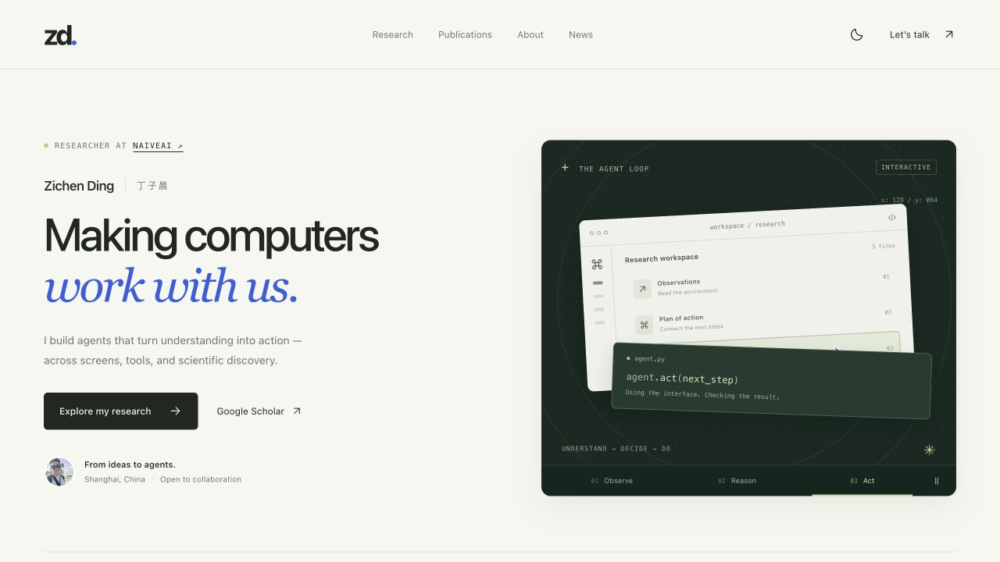

# Zichen Ding · Research Portfolio

A responsive academic homepage for Zichen Ding, built with Jekyll and deployed on GitHub Pages. The custom portfolio uses local assets and vanilla JavaScript, with no frontend build step or external font dependency.



[Mobile preview](docs/portfolio-mobile.png)

## Run locally

Install Ruby and Bundler, then run from this directory:

```sh
bundle install
bash run_server.sh
```

Open [localhost:4000](http://127.0.0.1:4000). To check the production build:

```sh
JEKYLL_ENV=production bundle exec jekyll build
```

The existing lockfile uses Bundler 2.2.19. If Bundler reports a version mismatch, install that version with `gem install bundler -v 2.2.19`. Local dependencies under `vendor/` and Bundler configuration are ignored by Git.

## Update content

- `_config.yml`: identity, email, social links, site URL, and description.
- `_data/publications.json`: the publication index. Each entry includes its title, full authors, venue, year, topic, resource links, and optional image / summary. Set `selected: true` to feature a paper. The homepage owner is highlighted automatically in author lists.
- `_data/news.json`: news entries, newest first; the first five appear before expanding the archive.
- `_includes/homepage.html`: biography, research directions, education, honors, service, and contact.
- `assets/css/portfolio.css`: responsive layout and light / dark themes.
- `assets/js/portfolio.js`: interactive agent sketch, publication explorer, theme preference, clipboard actions, and navigation.
- `images/previews/`: compressed publication and portrait previews. Original full-resolution images remain in `images/`.

Publication topics are `gui`, `science`, `language`, and `multimodal`. Text search includes all 27 publications, even when the Selected collection is active. Selecting a research direction also opens the complete matching bibliography. “Copy reference” copies a plain-text reference based on the saved metadata.

## Interaction & accessibility

- Click **Observe / Reason / Act** in the hero to explore the illustrative agent loop. Clicking a stage pauses autoplay; use the play button to resume.
- Search by title, author, venue, or year; press `/` to focus the search field. Filter by topic and sort by year.
- Expand publication details to read complete author lists and summaries.
- The theme follows the OS preference until the visitor chooses a theme; the choice is stored locally.
- Keyboard focus, a skip link, reduced-motion preferences, mobile navigation, empty search results, no-JavaScript reading, and print styles are supported.
- All academic content is rendered by Jekyll. Essential content and native disclosure elements remain available without JavaScript.

The Google Scholar crawler still publishes `gs_data.json` and `gs_data_shieldsio.json` on `google-scholar-stats`. The page refreshes citations from the existing CDN endpoint, with the raw GitHub endpoint as a fallback. `_data/scholar.json` holds a verified, dated snapshot for visitors who cannot reach either endpoint; update it from the same Scholar account, retaining its original `updated` date. The displayed date is the crawler's data date, not the visitor's current date. The workflow uses an isolated Python environment and updates the statistics branch without force-pushing. GitHub Pages can continue building from `main` using the repository's existing Pages configuration. Local edits do not publish until committed and pushed.

## Credits

Based on [AcadHomepage](https://github.com/RayeRen/acad-homepage.github.io), with a custom portfolio layout. The original template was influenced by Minimal Mistakes and AcademicPages. Original license notices and template files are retained; see `LICENSE`.

## Regression checks

Node.js 18+ is only needed for development tests, not for serving or publishing the site:

```sh
npm ci
bundle exec jekyll build
npm test
```

The tests exercise search / topic / collection / sort combinations, complete pagination, direct paper links, keyboard navigation, color preferences, reduced motion, denied storage and clipboard access, and Scholar endpoint / snapshot fallbacks. To test the production Pages build, also run `JEKYLL_ENV=production bundle exec jekyll build --safe`.

### Brand assets

The selected dual-77 mark is defined once in `_data/brand.json`. Run `npm ci` then
`npm run build:brand` after changing its geometry. This exports the SVG, 16/32px
favicons, multi-resolution ICO, touch and Android icons, including a separate
maskable icon with safe padding. The page header and footer use the same SVG path.

Company marks: NaiveAI's icon comes from `https://naive.ai/icon.svg` (retrieved
2026-10-20). Shanghai AI Laboratory uses the existing `images/logos/shailab-logo.svg`;
CSS crops its full lockup to the symbol for legibility beside the company name.
